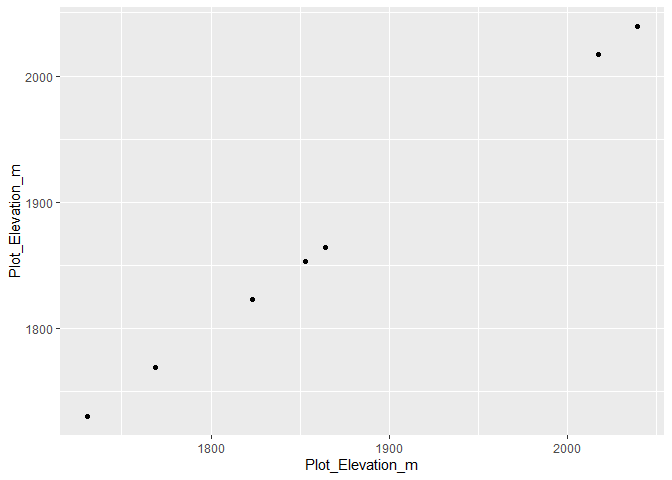
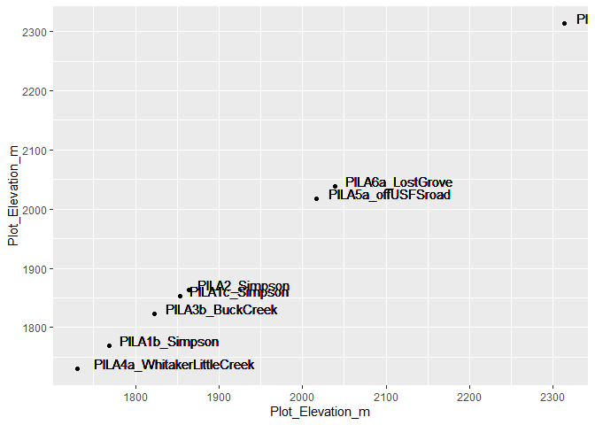
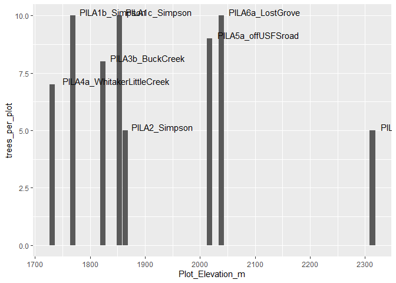
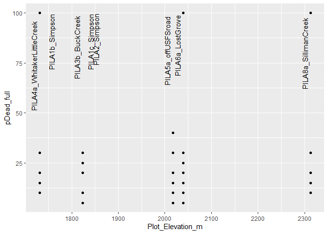
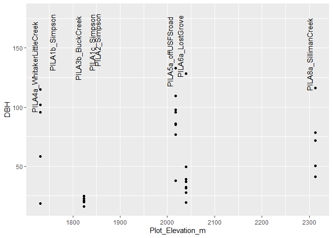
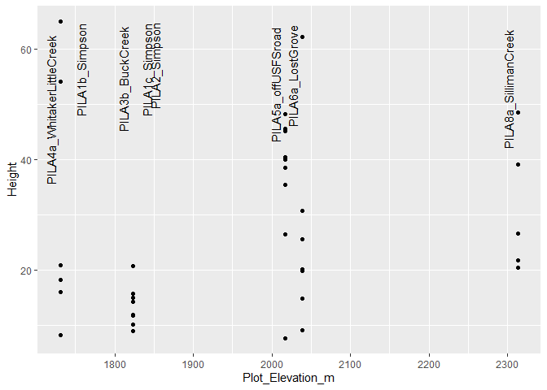
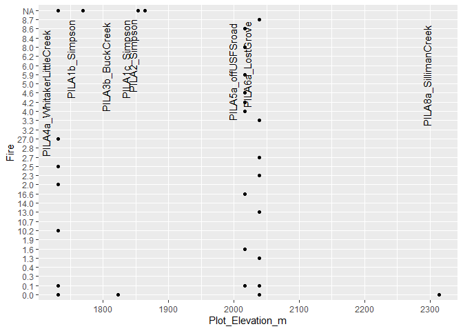

tree_data_exploration
================

``` r
library(googledrive)
library(tidyverse)
```

    ## ── Attaching core tidyverse packages ──────────────────────── tidyverse 2.0.0 ──
    ## ✔ dplyr     1.2.1     ✔ readr     2.2.0
    ## ✔ forcats   1.0.1     ✔ stringr   1.6.0
    ## ✔ ggplot2   4.0.3     ✔ tibble    3.3.1
    ## ✔ lubridate 1.9.5     ✔ tidyr     1.3.2
    ## ✔ purrr     1.2.2     
    ## ── Conflicts ────────────────────────────────────────── tidyverse_conflicts() ──
    ## ✖ dplyr::filter() masks stats::filter()
    ## ✖ dplyr::lag()    masks stats::lag()
    ## ℹ Use the conflicted package (<http://conflicted.r-lib.org/>) to force all conflicts to become errors

``` r
name_of_transcription_file_on_drive = "Copy of SEKI_2024_TreeFieldData_20260816" # store a copy of the file's name, exactly as it appears on Google Drive

dribble = drive_get(name_of_transcription_file_on_drive, corpus = "allDrives") # get necessary Google Drive metadata for downloading. This stores it in a special table called a "dribble". ** here, corpus = allDrives because this file does NOT live in the Bogar Lab drive; Jenny shared it with me
```

    ## ! Using an auto-discovered, cached token.

    ##   To suppress this message, modify your code or options to clearly consent to
    ##   the use of a cached token.

    ##   See gargle's "Non-interactive auth" vignette for more details:

    ##   <https://gargle.r-lib.org/articles/non-interactive-auth.html>

    ## ℹ The googledrive package is using a cached token for 'agoodman@ucdavis.edu'.

    ## Auto-refreshing stale OAuth token.

    ## ✔ The input `path` resolved to exactly 1 file.

``` r
# generate a file path and file name for the copy of the file you're about to make on your computer (in your local clone of this repository)
local_path <- paste0("Inputs/",                               # Path starts with "Inputs/" -- you may need to manually generate an Inputs sub-folder inside the folder where this .Rmd lives
                     name_of_transcription_file_on_drive,     # name starts identically to the name of the Google Drive version
                     "_downloaded-",                          # name specifies when you downlaoded the file
                     format(Sys.Date(), "%Y%m%d"),            # name includes today's date; auto-generated here
                     ".csv")                                  # name ends in file type extension. change from .csv only if this isn't a spreadsheet for some reason

# download the file from Google Drive
drive_download(dribble,             # finds the file on Google Drive, using the metadata you saved above
               type = "csv",        # specifies the kind of file to generate locally -- only change from csv if this isn't a spreadsheet
               path = local_path,   # specifies the new file path you just generated above
               overwrite = TRUE)    # maintains a maximum of one new version of this file that gets stored in the Inputs folder per day. 
```

    ## File downloaded:

    ## • 'Copy of SEKI_2024_TreeFieldData_20260816'
    ##   <id: 19Ni_wTk_1MtkI6GAOoclF_Aq583fumDgiAjGhE7KX3w>

    ## Saved locally as:

    ## • 'Inputs/Copy of SEKI_2024_TreeFieldData_20260816_downloaded-20261021.csv'

``` r
broad_treeData = read_csv(local_path) # reads the version of the file you downloaded today into your R environment (from your computer). You'll need a different function if it's not a csv
```

    ## New names:
    ## • `` -> `...32`
    ## • `` -> `...33`
    ## • `` -> `...34`

    ## Rows: 1399 Columns: 34
    ## ── Column specification ────────────────────────────────────────────────────────
    ## Delimiter: ","
    ## chr (19): Tucson_ID, Plot_ID, Plot_Name, Species, Aspect, Core, Waypoint_Num...
    ## dbl (12): Tree_Number, Slope, Elevation_m, Day, Month, Year, Northing, D_out...
    ## lgl  (3): Straw_Label, ...32, ...33
    ## 
    ## ℹ Use `spec()` to retrieve the full column specification for this data.
    ## ℹ Specify the column types or set `show_col_types = FALSE` to quiet this message.

``` r
name_of_transcription_file_on_drive = "SEKI_2024_PlotData" # store a copy of the file's name, exactly as it appears on Google Drive

dribble = drive_get(name_of_transcription_file_on_drive, corpus = "allDrives") # get necessary Google Drive metadata for downloading. This stores it in a special table called a "dribble". ** here, corpus = allDrives because this file does NOT live in the Bogar Lab drive; Jenny shared it with me
```

    ## ✔ The input `path` resolved to exactly 1 file.

``` r
# generate a file path and file name for the copy of the file you're about to make on your computer (in your local clone of this repository)
local_path <- paste0("Inputs/",                               # Path starts with "Inputs/" -- you may need to manually generate an Inputs sub-folder inside the folder where this .Rmd lives
                     name_of_transcription_file_on_drive,     # name starts identically to the name of the Google Drive version
                     "_downloaded-",                          # name specifies when you downlaoded the file
                     format(Sys.Date(), "%Y%m%d"),            # name includes today's date; auto-generated here
                     ".csv")                                  # name ends in file type extension. change from .csv only if this isn't a spreadsheet for some reason

# download the file from Google Drive
drive_download(dribble,             # finds the file on Google Drive, using the metadata you saved above
               type = "csv",        # specifies the kind of file to generate locally -- only change from csv if this isn't a spreadsheet
               path = local_path,   # specifies the new file path you just generated above
               overwrite = TRUE)    # maintains a maximum of one new version of this file that gets stored in the Inputs folder per day. 
```

    ## File downloaded:

    ## • 'SEKI_2024_PlotData' <id: 1IqNjzqB_nMU4Q57tJcr6CI-sSyGqUzXVY2UZF_gpPAQ>

    ## Saved locally as:

    ## • 'Inputs/SEKI_2024_PlotData_downloaded-20261021.csv'

``` r
plotData = read_csv(local_path) # reads the version of the file you downloaded today into your R environment (from your computer). You'll need a different function if it's not a csv
```

    ## Rows: 30 Columns: 37

    ## ── Column specification ────────────────────────────────────────────────────────
    ## Delimiter: ","
    ## chr (16): Plot_ID, Plot_Name, Crew, Plot_Route, Waypoint_Number_Beg, Waypoin...
    ## dbl (20): Day, Month, Year, Beg_Northing, Beg_Easting, Beg_Accuracy_ft, End_...
    ## lgl  (1): General_Vegetation_Notes
    ## 
    ## ℹ Use `spec()` to retrieve the full column specification for this data.
    ## ℹ Specify the column types or set `show_col_types = FALSE` to quiet this message.

``` r
name_of_transcription_file_on_drive = "EM Metadata entry, SEKI 2024" # store a copy of the file's name, exactly as it appears on Google Drive

dribble = drive_get(name_of_transcription_file_on_drive, shared_drive = 'Bogar Lab') # get necessary Google Drive metadata for downloading. This stores it in a special table called a "dribble".
```

    ## ✔ The input `path` resolved to exactly 1 file.

``` r
# generate a file path and file name for the copy of the file you're about to make on your computer (in your local clone of this repository)
local_path <- paste0("Inputs/",                               # Path starts with "Inputs/" -- you may need to manually generate an Inputs sub-folder inside the folder where this .Rmd lives
                     name_of_transcription_file_on_drive,     # name starts identically to the name of the Google Drive version
                     "_downloaded-",                          # name specifies when you downlaoded the file
                     format(Sys.Date(), "%Y%m%d"),            # name includes today's date; auto-generated here
                     ".csv")                                  # name ends in file type extension. change from .csv only if this isn't a spreadsheet for some reason

# download the file from Google Drive
drive_download(dribble,             # finds the file on Google Drive, using the metadata you saved above
               type = "csv",        # specifies the kind of file to generate locally -- only change from csv if this isn't a spreadsheet
               path = local_path,   # specifies the new file path you just generated above
               overwrite = TRUE)    # maintains a maximum of one new version of this file that gets stored in the Inputs folder per day. 
```

    ## File downloaded:

    ## • 'EM Metadata entry, SEKI 2024'
    ##   <id: 16FYOowA1RFZ1CQGPaj32ldMBXuV0rBZ26_sdiJ_SP2o>

    ## Saved locally as:

    ## • 'Inputs/EM Metadata entry, SEKI 2024_downloaded-20261021.csv'

``` r
rootSamplingData = read_csv(local_path) # reads the version of the file you downloaded today into your R environment (from your computer). You'll need a different function if it's not a csv
```

    ## Rows: 103 Columns: 29

    ## ── Column specification ────────────────────────────────────────────────────────
    ## Delimiter: ","
    ## chr (19): Extraction_ID, Trip_AnnaMemory, Location, Date, Species_code, Plot...
    ## dbl  (4): Stratum, Alias, date_ground_code, mg_tube_empty
    ## lgl  (6): Shoots 1-2m from trunk, Other tree notes, Corenotes_1, Corenotes_2...
    ## 
    ## ℹ Use `spec()` to retrieve the full column specification for this data.
    ## ℹ Specify the column types or set `show_col_types = FALSE` to quiet this message.

# Tidy broad tree data

``` r
pila_treeData = broad_treeData %>%
  filter(Species == "PILA") %>%
  mutate(Tree_Name = paste0(Plot_ID, "_", Tree_Number))
```

# Tidy plot data

``` r
pila_plots = plotData %>%
  filter(startsWith(Plot_Name, "PILA"))
```

# Tidy tree-level data for root-sampled trees

``` r
rootSamplingData = rootSamplingData %>%
  filter(startsWith(Plot_Name, "PILA")) %>%
  filter(Plot_Name != "PILA8c_TharpsLog PTAQ")
```

# Join plot data to root-sampled tree data

``` r
treeswroots_plots = left_join(rootSamplingData, pila_plots, by = "Plot_Name")

head(treeswroots_plots)
```

    ## # A tibble: 6 × 65
    ##   Extraction_ID Trip_AnnaMemory Location Date   Species_code Stratum Plot  Tree 
    ##   <chr>         <chr>           <chr>    <chr>  <chr>          <dbl> <chr> <chr>
    ## 1 1             Simpson Meadow  Simpson  26 Au… PILA               1 b     1    
    ## 2 2             Simpson Meadow  Simpson  26 Au… PILA               1 b     2    
    ## 3 3             Simpson Meadow  Simpson  26 Au… PILA               1 b     3    
    ## 4 4             Simpson Meadow  Simpson  26 Au… PILA               1 b     6    
    ## 5 5             Simpson Meadow  Simpson  26 Au… PILA               1 b     8    
    ## 6 6             Simpson Meadow  Simpson  26 Au… PILA               1 b     9    
    ## # ℹ 57 more variables: Plot_Name <chr>, Tree_Name <chr>, Alias <dbl>,
    ## #   number_of_cores <chr>, storage_type <chr>, date_ground_english <chr>,
    ## #   date_ground_code <dbl>, mg_tube_empty <dbl>, mg_tube_full <chr>,
    ## #   mg_roots_in_TD_tube <chr>, mg_roots_extra <chr>, grinding_notes <chr>,
    ## #   tree_mortality <chr>, `Immediately adjascent shoots` <chr>,
    ## #   `Shoots within 1m of trunk` <chr>, `Shoots 1-2m from trunk` <lgl>,
    ## #   `Other tree notes` <lgl>, Corenotes_1 <lgl>, Corenotes_2 <lgl>, …

# show elevation of trees

``` r
colnames(treeswroots_plots)
```

    ##  [1] "Extraction_ID"                "Trip_AnnaMemory"             
    ##  [3] "Location"                     "Date"                        
    ##  [5] "Species_code"                 "Stratum"                     
    ##  [7] "Plot"                         "Tree"                        
    ##  [9] "Plot_Name"                    "Tree_Name"                   
    ## [11] "Alias"                        "number_of_cores"             
    ## [13] "storage_type"                 "date_ground_english"         
    ## [15] "date_ground_code"             "mg_tube_empty"               
    ## [17] "mg_tube_full"                 "mg_roots_in_TD_tube"         
    ## [19] "mg_roots_extra"               "grinding_notes"              
    ## [21] "tree_mortality"               "Immediately adjascent shoots"
    ## [23] "Shoots within 1m of trunk"    "Shoots 1-2m from trunk"      
    ## [25] "Other tree notes"             "Corenotes_1"                 
    ## [27] "Corenotes_2"                  "Core1_suspect_contam_plants" 
    ## [29] "Core2_suspect_contam_plants"  "Plot_ID"                     
    ## [31] "Day"                          "Month"                       
    ## [33] "Year"                         "Crew"                        
    ## [35] "Plot_Route"                   "Waypoint_Number_Beg"         
    ## [37] "Beg_Northing"                 "Beg_Easting"                 
    ## [39] "Beg_Accuracy_ft"              "Waypoint_Number_End"         
    ## [41] "End_Northing"                 "End_Easting"                 
    ## [43] "End_Accuracy"                 "Transect_Length_m"           
    ## [45] "Transect_FieldWidth_m"        "Azimuth"                     
    ## [47] "Slope_beg"                    "Slope_end"                   
    ## [49] "Aspect_beg"                   "Aspect_end"                  
    ## [51] "Plot_Elevation_m"             "Associated_Tree_Species"     
    ## [53] "Other_Associated_Species"     "Soil_Types"                  
    ## [55] "Percent_Rock"                 "Prism_Number"                
    ## [57] "Prism_Species_1"              "Species_1_Number"            
    ## [59] "Regen_Species_1"              "Species_1_Saplings"          
    ## [61] "Regen_Species_2"              "Species_2_Saplings"          
    ## [63] "Alternate_hosts"              "Plot_Notes"                  
    ## [65] "General_Vegetation_Notes"

``` r
ggplot(treeswroots_plots, aes(x = Plot_Elevation_m, y = Plot_Elevation_m)) +
  geom_point()
```

    ## Warning: Removed 29 rows containing missing values or values outside the scale range
    ## (`geom_point()`).

<!-- -->
\# add missing elevation data

``` r
m_elev_7a = NA # blank on the scanned datasheet

m_elev_8a = c(2356, 2294, 2290) # three elevations listed on physical datasheet
m_elev_8a = mean(m_elev_8a)

m_elev_8b = NA # blank on the scanned datasheet
m_elev_8c = NA # blank on the scanned datasheet
```

``` r
pila_plots = pila_plots %>%
  mutate(Plot_Elevation_m = case_when(
    Plot_Name == "PILA8a_SillimanCreek" ~ m_elev_8a,
    .default = Plot_Elevation_m
  ))
```

## re-join plot data to root-sampled tree data

``` r
treeswroots_plots = left_join(rootSamplingData, pila_plots, by = "Plot_Name")

head(treeswroots_plots)
```

    ## # A tibble: 6 × 65
    ##   Extraction_ID Trip_AnnaMemory Location Date   Species_code Stratum Plot  Tree 
    ##   <chr>         <chr>           <chr>    <chr>  <chr>          <dbl> <chr> <chr>
    ## 1 1             Simpson Meadow  Simpson  26 Au… PILA               1 b     1    
    ## 2 2             Simpson Meadow  Simpson  26 Au… PILA               1 b     2    
    ## 3 3             Simpson Meadow  Simpson  26 Au… PILA               1 b     3    
    ## 4 4             Simpson Meadow  Simpson  26 Au… PILA               1 b     6    
    ## 5 5             Simpson Meadow  Simpson  26 Au… PILA               1 b     8    
    ## 6 6             Simpson Meadow  Simpson  26 Au… PILA               1 b     9    
    ## # ℹ 57 more variables: Plot_Name <chr>, Tree_Name <chr>, Alias <dbl>,
    ## #   number_of_cores <chr>, storage_type <chr>, date_ground_english <chr>,
    ## #   date_ground_code <dbl>, mg_tube_empty <dbl>, mg_tube_full <chr>,
    ## #   mg_roots_in_TD_tube <chr>, mg_roots_extra <chr>, grinding_notes <chr>,
    ## #   tree_mortality <chr>, `Immediately adjascent shoots` <chr>,
    ## #   `Shoots within 1m of trunk` <chr>, `Shoots 1-2m from trunk` <lgl>,
    ## #   `Other tree notes` <lgl>, Corenotes_1 <lgl>, Corenotes_2 <lgl>, …

``` r
ggplot(treeswroots_plots, aes(x = Plot_Elevation_m, y = Plot_Elevation_m)) +
  geom_point() + 
  geom_text(aes(label = Plot_Name), vjust = 0, hjust = -0.1)
```

    ## Warning: Removed 24 rows containing missing values or values outside the scale range
    ## (`geom_point()`).

    ## Warning: Removed 24 rows containing missing values or values outside the scale range
    ## (`geom_text()`).

<!-- -->

``` r
for_elev_hist = treeswroots_plots %>%
  group_by(Plot_Name) %>%
  summarise(Plot_Elevation_m = median(Plot_Elevation_m), trees_per_plot = n())

head(for_elev_hist)
```

    ## # A tibble: 6 × 3
    ##   Plot_Name                  Plot_Elevation_m trees_per_plot
    ##   <chr>                                 <dbl>          <int>
    ## 1 PILA1b_Simpson                         1769             10
    ## 2 PILA1c_Simpson                         1853             10
    ## 3 PILA2_Simpson                          1864              5
    ## 4 PILA3b_BuckCreek                       1823              8
    ## 5 PILA4a_WhitakerLittleCreek             1731              7
    ## 6 PILA5a_offUSFSroad                     2017              9

``` r
ggplot(for_elev_hist, aes(x = Plot_Elevation_m, y = trees_per_plot)) +
  geom_bar(stat = "identity") +
  geom_text(aes(label = Plot_Name), vjust = 0, hjust = -0.1)
```

    ## Warning: Removed 3 rows containing missing values or values outside the scale range
    ## (`geom_bar()`).

    ## Warning: Removed 3 rows containing missing values or values outside the scale range
    ## (`geom_text()`).

<!-- -->

# Join broad tree data to root-sampled tree data

``` r
treeswroots = left_join(treeswroots_plots, pila_treeData, by = "Tree_Name")

head(treeswroots)
```

    ## # A tibble: 6 × 99
    ##   Extraction_ID Trip_AnnaMemory Location Date   Species_code Stratum Plot  Tree 
    ##   <chr>         <chr>           <chr>    <chr>  <chr>          <dbl> <chr> <chr>
    ## 1 1             Simpson Meadow  Simpson  26 Au… PILA               1 b     1    
    ## 2 2             Simpson Meadow  Simpson  26 Au… PILA               1 b     2    
    ## 3 3             Simpson Meadow  Simpson  26 Au… PILA               1 b     3    
    ## 4 4             Simpson Meadow  Simpson  26 Au… PILA               1 b     6    
    ## 5 5             Simpson Meadow  Simpson  26 Au… PILA               1 b     8    
    ## 6 6             Simpson Meadow  Simpson  26 Au… PILA               1 b     9    
    ## # ℹ 91 more variables: Plot_Name.x <chr>, Tree_Name <chr>, Alias <dbl>,
    ## #   number_of_cores <chr>, storage_type <chr>, date_ground_english <chr>,
    ## #   date_ground_code <dbl>, mg_tube_empty <dbl>, mg_tube_full <chr>,
    ## #   mg_roots_in_TD_tube <chr>, mg_roots_extra <chr>, grinding_notes <chr>,
    ## #   tree_mortality <chr>, `Immediately adjascent shoots` <chr>,
    ## #   `Shoots within 1m of trunk` <chr>, `Shoots 1-2m from trunk` <lgl>,
    ## #   `Other tree notes` <lgl>, Corenotes_1 <lgl>, Corenotes_2 <lgl>, …

# compare tree data across elevation

## many plots have yet to have full tree data entered here

### percent of tree (branches/canopy) dead, assesed by jenny. not sure how pDead_full relates to pDead_rg or which should be considered, though

``` r
ggplot(treeswroots, aes(x = Plot_Elevation_m, y = pDead_full)) +
  geom_point() + 
  geom_text(
    data = treeswroots %>% distinct(Plot_Name.x, Plot_Elevation_m),
    aes(x = Plot_Elevation_m, y = Inf, label = Plot_Name.x),

    angle = 90,
    vjust = -0.5,
    hjust = 1.2
  )
```

    ## Warning: Removed 50 rows containing missing values or values outside the scale range
    ## (`geom_point()`).

    ## Warning: Removed 3 rows containing missing values or values outside the scale range
    ## (`geom_text()`).

<!-- -->

### tree diameter at breast height

``` r
ggplot(treeswroots, aes(x = Plot_Elevation_m, y = DBH)) +
  geom_point() + 
  geom_text(
    data = treeswroots %>% distinct(Plot_Name.x, Plot_Elevation_m),
    aes(x = Plot_Elevation_m, y = Inf, label = Plot_Name.x),

    angle = 90,
    vjust = -0.5,
    hjust = 1.2
  )
```

    ## Warning: Removed 50 rows containing missing values or values outside the scale range
    ## (`geom_point()`).

    ## Warning: Removed 3 rows containing missing values or values outside the scale range
    ## (`geom_text()`).

<!-- -->
oop! little trees only at pila3b

### tree height

``` r
ggplot(treeswroots, aes(x = Plot_Elevation_m, y = Height)) +
  geom_point() +
  geom_text(
    data = treeswroots %>% distinct(Plot_Name.x, Plot_Elevation_m),
    aes(x = Plot_Elevation_m, y = Inf, label = Plot_Name.x),

    angle = 90,
    vjust = -0.5,
    hjust = 1.2
  )
```

    ## Warning: Removed 50 rows containing missing values or values outside the scale range
    ## (`geom_point()`).

    ## Warning: Removed 3 rows containing missing values or values outside the scale range
    ## (`geom_text()`).

<!-- -->

``` r
ggplot(treeswroots, aes(x = Plot_Elevation_m, y = Fire)) +
  geom_point() + 
  geom_text(
    data = treeswroots %>% distinct(Plot_Name.x, Plot_Elevation_m),
    aes(x = Plot_Elevation_m, y = Inf, label = Plot_Name.x),

    angle = 90,
    vjust = -1,
    hjust = 1.2
  )
```

    ## Warning: Removed 24 rows containing missing values or values outside the scale range
    ## (`geom_point()`).

    ## Warning: Removed 3 rows containing missing values or values outside the scale range
    ## (`geom_text()`).

<!-- -->
